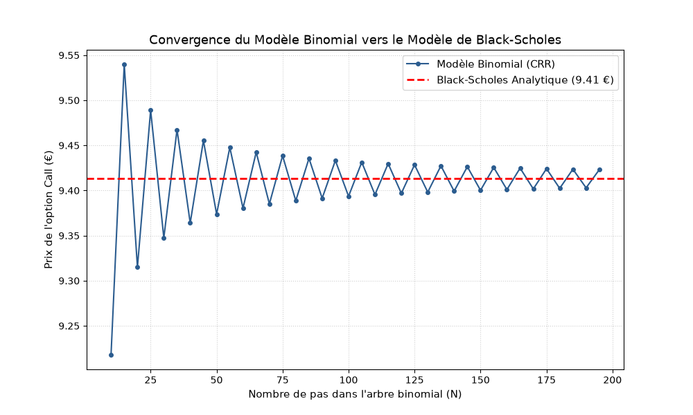

# Évaluation d'Options Financières : Modèle de Black-Scholes vs Arbre Binomial (CRR)

Ce projet compare la méthode analytique continue de **Black-Scholes (1973)** et la méthode numérique discrète de **l'Arbre Binomial de Cox-Ross-Rubinstein (CRR)** pour le pricing d'options d'achat (*Call*) européennes et l'étude de la convergence numérique.

## 📌 Contenu du Projet

- **`black_scholes_binomial.py`** : Script Python calculant le prix analytique, le Grec Delta ($\Delta$), ainsi que l'algorithme de rétro-propagation pour l'arbre binomial à $N$ pas.
- **`black_scholes_results.png`** : Graphique illustrant la convergence des prix binomiaux vers la valeur théorique de Black-Scholes.
- **`report.pdf`** : Rapport académique complet rédigé en $\LaTeX$ contenant les démonstrations mathématiques et calculs de sensibilités.

## 🛠️ Technologies Utilisées

* **Python** (`NumPy`, `SciPy`, `Matplotlib`)
* **$\LaTeX$** (Rédaction du rapport théorique)

## 📊 Résultats & Convergence

Le projet démontre empiriquement que lorsque le nombre de pas $N$ de l'arbre binomial augmente, le prix discret converge de manière oscillatoire vers la solution analytique de l'équation aux dérivées partielles (EDP) de Black-Scholes.

## 📄 Rapport Académique

Pour consulter les démonstrations théoriques complètes et les équations différentielles :  
👉 **[Consulter le rapport complet (PDF)](./Modele-Black-Scholes-et-Arbre-Binomial.pdf)**
## 📊 Aperçu des Résultats

